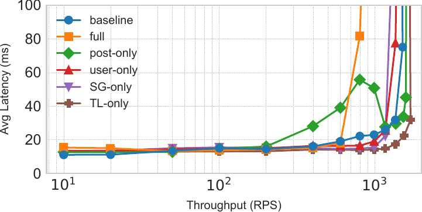

# Monolift thesis direction

**Monolift asks which deployment boundaries can be derived from an existing Go application, and when a Kubernetes control plane should use them.** Today, teams choose those boundaries when they structure and package the application. Kubernetes can place and scale the resulting components, but it cannot choose to run a particular operation in-process instead of across the network. Monolift aims to expose that choice where it is valid, without requiring a new application framework. Developers can introduce candidate boundaries incrementally and still run the original program without the compiler.

Separating application structure from deployment matters because independent scaling and isolation come with communication overhead and backpressure. The [Segment](https://www.infoq.com/news/2020/04/microservices-back-again/) and [Prime Video monitoring](https://archive.is/h788m) cases illustrate the costs of particular boundaries, not a general case for monoliths. [Service Weaver](https://github.com/ServiceWeaver/weaver#readme) illustrates a separate problem: moving an existing application into a component framework can require substantial rewriting.

## What the workshop experiments showed (proposal §4)

The [PLOS ’25 paper](https://dl.acm.org/doi/10.1145/3764860.3768327) used a Go port of [DeathStarBench](https://dl.acm.org/doi/10.1145/3297858.3304013) Social Network as a monolithic baseline. The packages (`user`, `post`, `timeline`, and `socialgraph`) were already organized by function. The port replaced synchronous RPCs with direct interface calls that preserved the call graph, and kept asynchronous message formats while moving queues into memory. The prototype used annotations to extract selected interfaces as services and generated clients for remote calls. We call the extracted functionality a *lift*. Both experiments ran on an eight-node Kubernetes cluster of 40-core servers with the application initialized from the `Reed98` social graph.

### Static boundaries under a fixed CPU budget

We generated five deployments from the same source and compared them with the monolith under a workload of post creation requests. Each variant had 32 CPU cores in total, with no autoscaling. Each extracted component ran on a separate node.

| Configuration | Entrypoint CPU cores | Extracted components |
| --- | ---: | --- |
| Monolith | 32 | None |
| All four lifts | 16 | 4 cores per lift |
| One lift (four separate runs: user, post, timeline, or socialgraph) | 16 | 16 cores for the selected lift |

*PLOS ’25 Figure 3. TL = timeline; SG = socialgraph.*

**Timeline-only extraction gave a better throughput and average latency tradeoff than either the monolith or full extraction.** The other single-component cuts gave different results. This shows that the boundary matters for this workload even at equal total CPU. It does not establish that timeline is the best cut under other workloads or allocations.

### Local versus remote execution as demand rises

Using the timeline boundary from the first experiment, a developer-written *delegate expression* sent timeline operations to a dedicated service when their rate exceeded **100 requests per second**. The experiment increased input load over time and compared this policy with the monolith and the original microservice implementation. The threshold applies to **timeline operations**, not to the overall input rate plotted on the right axis.

*PLOS ’25 Figure 4. The dashed curve is input load. The paper reports tail latency without specifying the percentile.*

The monolith had low tail latency until it saturated. The microservice implementation paid a latency cost at low load but held up as demand rose. Monolift ran timeline operations locally at low load, with latency close to the monolith, and remotely at higher load, with tail latency about **20% lower** than the microservice implementation. This was one hand-tuned policy on one application. It shows why adaptation may help, not how to choose a boundary or threshold in general. It also shows a change in where calls execute, not live migration of program state.

## Proposed work: valid partitions and sound transformations (proposal §5)

A *partition* is a region of code and the state it owns. A *boundary operation* transfers control and data between partitions. The research question is which partitions Go programs admit under an explicit model, how individual cuts compose into a valid partitioning, and what the compiler can establish about the resulting program.

The model deliberately excludes distributed shared memory, synchronization of mutable state across instances, migration of running computations, and added durability for local state. State that needs to survive a restart must already live in an external durable store. Network failure remains visible to the application.

- **Ownership:** Only the owning partition directly reads or writes a mutable location. Other partitions go through boundary operations. Analysis must account for aliases through receivers, closures, globals, and dependencies, not only the types in a signature. An ephemeral singleton counter still needs one authoritative instance; permission to reset on restart does not make independent replicas interchangeable.
- **Value passing:** Arguments and results cross as copies, with supported values preserved by encoding and decoding. Copying a Go value that contains pointers or shares backing storage cannot silently remove mutations the caller depends on.
- **Call replacement:** In normal operation, extraction and generated RPCs should preserve results, state changes, and external effects under stated assumptions. The compiler must bring along the required code and dependencies, distinguish owned memory from access to external resources, and refuse cases whose preconditions it cannot establish. Cuts may overlap or nest; individually plausible cuts need not work together.
- **Failure semantics:** A timeout or lost response can leave completion uncertain. An error result gives the program a way to report failure, not proof that callers handle it correctly. Neither retry nor local fallback is safe by default, and exactly-once execution is not assumed. The invocation contract must say what each outcome means and when another attempt is permitted.

The goal is a characterization of admissible Go partitions, soundness arguments for supported transformations, and a compiler that implements them. The evaluation will separate conditions established by analysis from assumptions about deployment and runtime behavior. Pure computations, singleton services with ephemeral state, and operations on external resources will exercise accepted and refused boundaries, generated calls, lost requests or responses, and restarts. Coverage and empirical comparisons complement the soundness argument; they do not replace it. Aliasing, dependencies the compiler cannot analyze, and discrepancies between the model and generated code are key risks.

The workshop provided a modular setting for testing placement. The [v2 compiler work](https://github.com/tgoodwin/monolift/blob/main/docs/site/docs/v1-to-v2.md) and [real Go application corpus](https://github.com/tgoodwin/monolift/blob/main/docs/evaluation/README.md) expose harder boundaries and dependencies. The thesis uses both as evidence, rather than treating support for arbitrary Go as a prerequisite. The [semantic partitioning agenda](https://github.com/tgoodwin/monolift/blob/main/docs/research/2026-10-13-partitioning-research-agenda-v1.md) records the broader questions that led to this scope.

## Proposed work: adaptive deployment control (proposal §6)

**The compiler and runtime define which deployments are supported; the controller chooses when to use them.** Instead of requiring a delegate expression at each lift, a centralized Kubernetes controller would use application signals such as demand alongside cluster signals such as available nodes and capacity. It would select among supported alternatives and coordinate generated components with Kubernetes orchestration. The policy cannot make an unsupported boundary valid.

A valid target deployment does not imply a valid transition from the current deployment. The controller and runtime need a protocol for requesting a change, checking preconditions, and determining whether it completed. The protocol must account for routing, state ownership, operations already in flight, and what callers observe if a transition fails. A local-to-remote switch that would require copying live mutable state is not an available action under this model. The work must distinguish transitions it can realize from those that require more machinery or must be refused.

The integrated evaluation will vary both demand and available cluster capacity, comparing adaptive behavior with fixed deployments. It will measure application outcomes and adaptation overhead, and check whether the controller respects transition preconditions. It should identify when adaptation helps, when it does little, and when switching costs or incomplete observations make it worse. Evidence about the resulting deployments is distinct from evidence about the switches themselves.

Resource managers such as [Cilantro](https://www.usenix.org/conference/osdi23/presentation/bhardwaj), [Sinan](https://dl.acm.org/doi/10.1145/3445814.3446693), and [Sage](https://dl.acm.org/doi/10.1145/3445814.3446700) are policy context; Monolift’s focus is expanding the set of deployment choices those kinds of policies could act on. An operational agent could eventually consume the same constrained interface ([AIOpsLab](https://arxiv.org/abs/2501.06706) and [STRATUS](https://arxiv.org/abs/2506.02009) are examples of related work). Agent-driven operation is optional, not part of the core result.

## Relationship to Kamera

The thesis treats Kamera and Monolift as complementary threads on adaptive cloud systems. Kamera makes multi-controller executions explorable and testable; Monolift expands the deployment choices exposed to those controllers. This repository documents the managed-application side: how to derive valid alternatives and what a controller may safely ask the runtime to do. It does not claim that the compiler solves controller coordination, or that the controller can make an invalid transformation valid.

## Scope and milestones

The core deliverable is an integrated compiler and controller with stated guarantees and evaluated behavior. The compiler’s validity rules and transformation preconditions inform the controller interface; controller scaffolding and workload preparation can proceed in parallel. Broader transformation coverage is optional. The proposal targets a single Monolift paper for OOPSLA in spring 2027 and dissertation completion in fall 2027. These are provisional targets, not release commitments.

*Source: the thesis proposal working tree, especially §§4–6 (`sections/monolift.tex`, `sections/liftability.tex`, and `sections/adaptive-control.tex`), plus its introduction, related work, and research plan. The plots are rendered from the proposal’s copies of the published workshop figures. This page describes the research direction, not an inventory of implemented features or a benchmark reproduction guide.*
